<h1 align="center"><b>cross-review</b></h1>

<p align="center"><a href="https://cross-review.tlelabs.com">cross-review.tlelabs.com</a> · <a href="https://www.npmjs.com/package/@tlelabs/cross-review">npm</a></p>

<p align="center">
  <a href="https://www.npmjs.com/package/@tlelabs/cross-review"></a>
  <a href="https://github.com/lploc94/cross-review/actions/workflows/ci.yml"></a>
  <a href="https://github.com/lploc94/cross-review/actions/workflows/release.yml"></a>
  <a href="https://www.npmjs.com/package/@tlelabs/cross-review"></a>
  <a href="LICENSE"></a>
</p>

Cross-model review skills for [Claude Code](https://docs.anthropic.com/en/docs/claude-code), [OpenAI Codex CLI](https://github.com/openai/codex), and [Antigravity CLI](https://antigravity.google/docs): the agent you work with orchestrates, and a second model reviews its plans, code and reasoning under a compiled 3-layer Principal Reviewer system prompt. The reviewer is the Codex CLI by default; Claude Code (`claude`) and Antigravity (`agy`) can review too. The runner drives each reviewer CLI through its own adapter (`scripts/lib/reviewers/`).

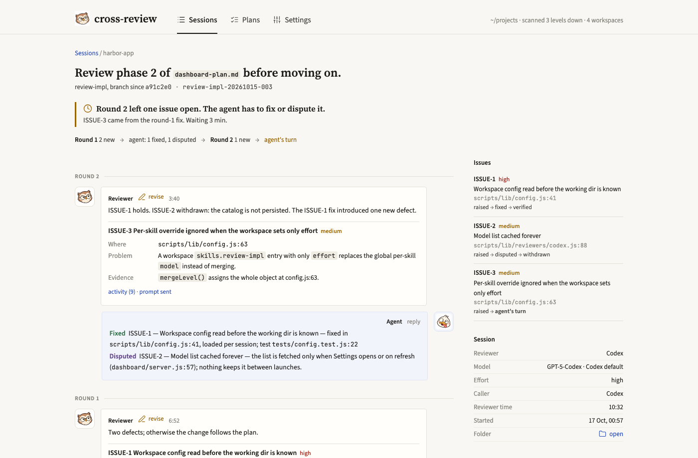

Six skills (Claude Code & Antigravity: `/name`, Codex: `$name`):
- `loop-plan` — write a phased, code-grounded implementation plan for large, multi-feature work
- `loop-implement` — execute an approved loop plan phase by phase with TDD, checkpoint reviews, and commits
- `review-plan` — debate implementation plans before coding
- `review-impl` — review uncommitted changes, unpushed commits, or a branch before commit/push/merge
- `review-think` — peer reasoning/debate on technical topics
- `review-pr` — review someone else's PR as a peer (correctness, description, merge readiness); your own PR goes through `review-impl`

This project was called **codex-review** (`lploc94/codex_skill`, skills `codex-plan-review`, `codex-impl-review`, `codex-think-about`, `codex-commit-review`, `codex-pr-review`). Installing removes that pack's skills, runtime and MCP server registration. Finish any review that is still running before you update: sessions started under the old names cannot be resumed.

## Benchmark: which reviewer to pick

We gave the same 168 pull requests (144 with planted bugs, clean ones and decoys, plus 24 real bugs from open source) to Codex (`gpt-6-astra`), Claude Code (`claude-opus-5-5`) and Antigravity (`gemini-4-argon`), three runs each at effort `high`, all through `review-impl`, and graded every finding blind with a three-judge panel and an audit. The method was pre-registered. Full write-up: [cross-review.tlelabs.com/benchmark](https://cross-review.tlelabs.com/benchmark/); code, public tasks and report: [lploc94/cross-review-bench](https://github.com/lploc94/cross-review-bench).

- **Codex and Claude Code find the most bugs**: about 90% of the planted bug weight, with no significant gap between them.
- **Antigravity raises the fewest false alarms**: 87% of its findings were real, and it asked for changes on 5% of correct pull requests, against 21% for Claude Code and 48% for Codex. That gives it the best F1, but it misses more of the hard bugs.
- **Claude Code is the best all-rounder**: Codex-level detection, less than half of Codex's false alarms, and the fastest median run (141 s).
- **On real bugs Codex leads** (F1 0.58, Claude Code 0.53, Antigravity 0.45).
- **A second model did not fix more bugs**: when Claude Code or Codex fixed buggy pull requests, adding a reviewer did not raise the share fixed over the agent reviewing its own work.

Planted corpus (144 pull requests); brackets are 95% bootstrap intervals over tasks:


Detection against noise (the dotted curves are equal F1):


False alarms: the share of correct pull requests (clean or decoy) on which the reviewer asked for changes over something that was not a bug:


Recall by difficulty, from L1 (visible in the diff) to L4 (needs running the code):


Real defects nobody planted, confirmed by the audit (60 in all):


Real bugs from public repositories, fixed after every model's training cutoff (21 scored):


The second round: does the reviewer accept a correct fix, catch a wrong one, and hold against a false rebuttal?


Fix loops: share of bugs fixed when Claude Code or Codex fixes 40 buggy pull requests alone or with each reviewer:


Median time per review run:


Pick Codex or Claude Code when a missed bug costs more than a false alarm, Antigravity when noise is the problem, and Claude Code for a balance of both. See [Choosing the reviewer](#choosing-the-reviewer-optional).

## Requirements

- Node.js >= 22 and npm
- [Claude Code](https://docs.anthropic.com/en/docs/claude-code) CLI and/or [Codex CLI](https://github.com/openai/codex)
- At least one reviewer CLI in PATH, signed in:
  - `codex` ([Codex CLI](https://github.com/openai/codex), an OpenAI account or API key): the default reviewer
  - `claude` ([Claude Code](https://docs.anthropic.com/en/docs/claude-code))
  - `agy` ([Antigravity CLI](https://antigravity.google/docs))
- macOS, Linux or Windows. On Windows the reviewer CLIs may be `.exe` files or npm installs (`.cmd`), and the `cross-review` command works in PowerShell 7, cmd and Git Bash

## Install

```bash
npx @tlelabs/cross-review
```

From GitHub instead: `npx github:lploc94/cross-review`.

### What it does
1. Installs the skills for Claude Code into `~/.claude/skills/`, for Codex into `~/.agents/skills/`, and for Antigravity (`agy`) as the `cross-review` plugin into `~/.gemini/config/plugins/cross-review/` (including 6 skills, 4 reviewer agents `cross-reviewer-review-{impl,plan,pr,think}`, and enabling the plugin in `~/.gemini/config/config.json`)
2. Installs the shared runtime (runner, MCP server, `build-prompts.js`, compiled 3-layer reviewer prompts, and dependencies from the lock file) into `~/.claude/skills/cross-review/`
3. Renders each SKILL.md with the shared review protocol and the absolute runner path
4. Registers the `cross-review` MCP server with Claude Code (user scope), Codex, and Antigravity (`~/.gemini/config/mcp_config.json`)
5. Swaps directories atomically with rollback on failure; removes the old `codex-review` pack and this pack's copies in `~/.codex/skills`
6. Writes the `cross-review` command, a small script that runs the installed runner: `~/.local/bin/cross-review` on macOS and Linux; on Windows `cross-review.cmd`, `cross-review.ps1` and `cross-review` (for Git Bash) in npm's global folder (`npm prefix -g`, usually `%APPDATA%\npm`, which is on your `PATH`). A file of that name the installer did not write is left alone. When the folder is not on your `PATH`, the installer says so

Windows PowerShell 5.1 blocks `.ps1` files by default: type `cross-review.cmd` there, or allow local scripts with `Set-ExecutionPolicy -Scope CurrentUser RemoteSigned`. PowerShell 7 runs them as they are.

### Verify
```bash
node ~/.claude/skills/cross-review/scripts/review-runner.js version   # 15
claude mcp get cross-review
codex mcp get cross-review
```

### Reinstall / Update
```bash
npx @tlelabs/cross-review@latest
```
Re-running is safe: the MCP registration is replaced, not duplicated.

### Automatic reviews (optional)
```bash
npx @tlelabs/cross-review --auto
```
Adds a block to `~/.claude/CLAUDE.md` and `~/.gemini/GEMINI.md` that has Claude Code and Antigravity use the `review-plan` skill after finishing any plan and the `review-impl` skill after finishing any implementation, without asking first. This applies to every plan and implementation, not only `loop-plan` and `loop-implement`. It skips trivial changes, reviews a loop skill already ran, and reviews you asked it to skip. The other skills are never run automatically. Idempotent — safe to re-run. Every install, with or without `--auto`, refreshes a block that is already there, including one written by the old codex-review pack.

## Usage

- `loop-plan` writes a `loop-plan/v1` plan with review checkpoints into `<repo>/.cross-review/plans/`; it is approved by `review-plan` or by you.
- `loop-implement` executes the approved plan, ticks each acceptance criterion it meets (`- [x]`), and runs `review-impl` at the plan's checkpoints.
- The review skills use the MCP tools `review_begin`, `review_wait`, `review_reply`, `review_end`. Without MCP, or in a mode that refuses the tools, they run the same verbs through the CLI: `node ~/.claude/skills/cross-review/scripts/review-runner.js begin|wait|reply|end`.
- Review sessions and plans live in `<repo>/.cross-review/`, which ignores itself in git. Plans stay out of git too unless you turn on **Plans in git** (below).

The reviewer runs with full access so it can run tests and network commands (`curl`, `npm view`, `git fetch`) to check its findings; its prompts forbid changing project files.

Decision points: every regex, parser, guard, allow/deny list, default, fallback, timeout, retry or numeric bound a change adds needs a grounded source (real samples, a cited specification, or an exhaustive test) and a check of what it misses and what legitimate input it blocks. The reviewer blocks approval on an ungrounded one and lists each in a `### Decision Ledger` table; a test that still passes with the fix disabled is a `high` finding.

### Choosing the reviewer (optional)

Codex reviews unless you choose another reviewer:
- for one review, name it when you ask ("review this with Claude Code"); the skill passes `reviewer` (`codex`, `claude` or `agy`) to `review_begin`, and the session keeps it for every round;
- as a default, set `"reviewer"` in `~/.cross-review/config.json` or `<workspace>/.cross-review/config.json`, or pick it in the dashboard's Settings.

Each reviewer keeps its own model and effort under `reviewers.<name>`, so switching reviewers never hands one CLI another's model:

```json
{
  "reviewer": "claude",
  "reviewers": {
    "codex": { "model": "<codex model>", "effort": "high" },
    "claude": { "model": "opus", "effort": "max", "skills": { "review-pr": { "effort": "high" } } },
    "agy": { "model": "<agy model family>", "effort": "low" }
  }
}
```

- **Codex**: the models `codex debug models` lists; effort as Codex names it.
- **Claude Code**: the aliases (`opus`, `sonnet`, …) or a full model name; effort `low`, `medium`, `high`, `xhigh` or `max`.
- **Antigravity**: `agy models` lists one model per effort (`<family>-low`, `<family>-high`, …). Pick the family and an effort, and the runner passes both to agy (`--model <family> --effort <level>`); a model listed without levels takes no effort. A level the family lacks fails before the review starts.

`model`, `effort` and `skills` at the top of a file are the older form of `reviewers.codex` and are still read that way; the dashboard saves them under `reviewers.codex`.

A reviewer never starts a review of its own: the runner marks the reviewer's environment (`CROSS_REVIEW_REVIEWER`), and a `begin` inside it fails with `NESTED_REVIEW`. This matters most when Claude Code reviews, since the cross-review skills are installed for it too.

### Choose a model (optional)

Name a model or effort when you ask for a review (or in a plan's review checkpoint). The skill passes it to `review_begin`; the runner stores it and reuses it for every later round. Without one, the runner applies the dashboard settings (below) for the chosen reviewer, else the reviewer CLI's default model and effort `high`.

## Dashboard

```bash
cross-review dashboard                             # the command the installer writes (~/.local/bin, or npm's folder on Windows)
npx @tlelabs/cross-review dashboard               # without installing
```

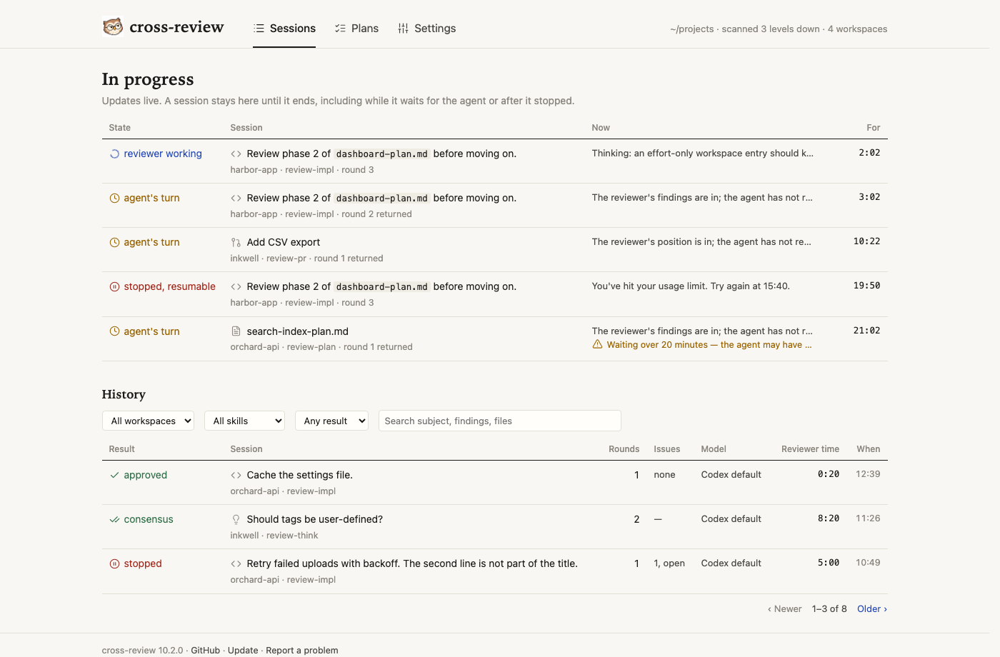

| Plans: a plan's progress | Settings |
| --- | --- |
| 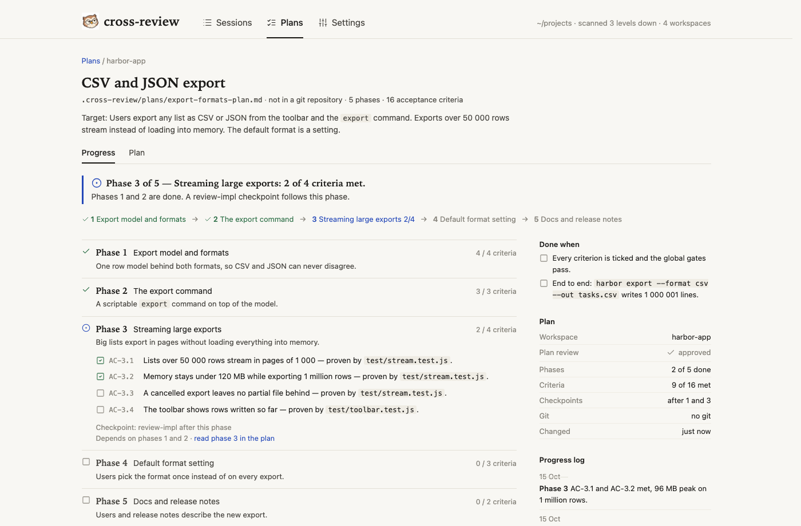 | 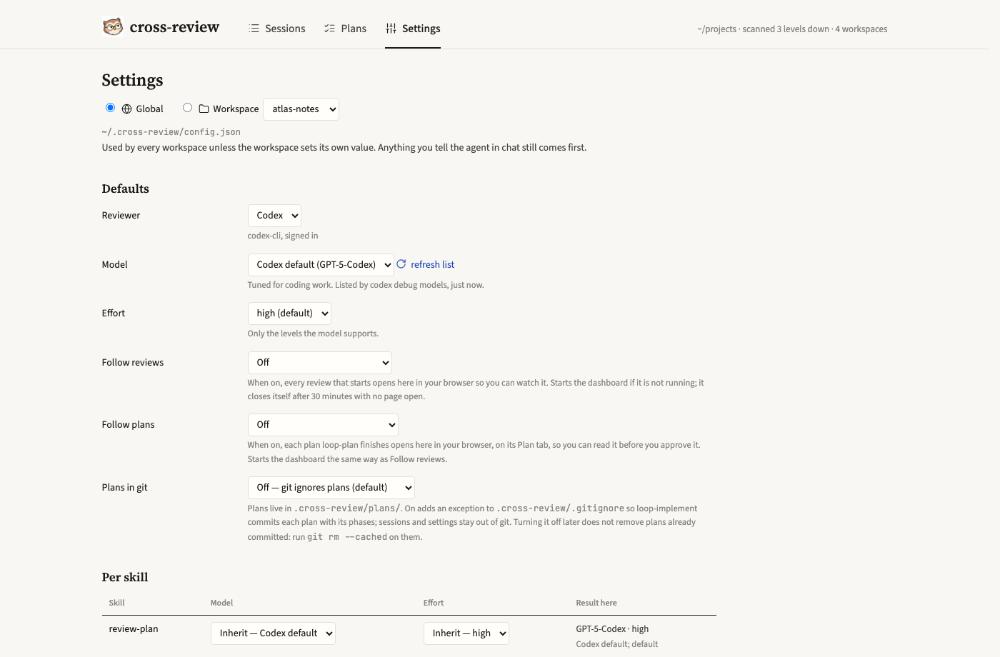 |

Starts a local web page and opens it in your browser. It lists the review sessions and plans in the folder you start it from and up to 3 levels below. Options: `--root <dir>` scans another folder, `--port <n>` picks the port (default: a random free one), `--no-open` only prints the link, `--idle-exit <s>` stops the server after that many seconds with no page open.

- **Sessions**: reviews in progress (reviewer working, waiting for the agent, stopped) update live; History lists the finished ones with filters. A review left waiting for the agent, or stopped, for over an hour moves to History (`no reply` or `stopped`) and comes back when the agent resumes it. A session's page shows the conversation round by round, the issue ledger, and what the reviewer is doing right now. The dashboard only reads sessions; it never starts, stops or answers one.
- **Plans**: every plan in `.cross-review/plans/` with its state (draft, in review, ready, phase N of M, done) and progress, live. A plan's page has two tabs: **Progress** (phases, their criteria, checkpoints, commits, the progress log) and **Plan** (the whole file with its contents). Another `.md` file in that folder shows as a plain document. Plans elsewhere in the repository are not shown.
- **Settings**: the reviewer, and each reviewer's model and effort, that a review uses when you do not name them, saved as you change them, globally (`~/.cross-review/config.json`) or for one workspace (`<workspace>/.cross-review/config.json`, ignored by git), with overrides per skill. **Model and effort for** picks which reviewer's values the form shows. First match wins: what you tell the agent in chat · workspace, this skill · workspace · global, this skill · global · the reviewer's default model and effort `high`. Model lists come from `codex debug models` and `agy models` (kept in `~/.cross-review/models.json` and `models-agy.json`, so Settings opens at once while it asks again); Claude Code shows its aliases, and **Other…** takes a full model name.
- **Follow reviews**: when on, every review that starts opens its page in your browser, starting the dashboard if it is not running; that dashboard closes itself after 30 minutes with no page open.
- **Follow plans**: when on, each plan `loop-plan` finishes opens on its Plan tab the same way, so you can read it before you approve it.
- **Plans in git**: off by default. On adds an exception for `plans/` to `.cross-review/.gitignore`, so `loop-implement` commits the plan with each phase; sessions and settings stay out of git. A root `.gitignore` that ignores `.cross-review/` itself overrides that exception: change it to `.cross-review/*` and add `!.cross-review/plans/` (the dashboard and `loop-plan` warn when this happens). Turning it off later does not remove plans already committed: run `git rm --cached` on them.
- **Check for updates**: off by default. When on, the dashboard reads the latest version on npm when it starts (at most every 3 days) and every 6 hours while it runs, and the footer says when a newer one is out; **Check now** asks at any time. Nothing about you or your sessions is sent.
- **Avatars**: pick an image for you, the reviewer and each agent (PNG, JPEG, WebP or GIF, up to 1 MB). Images stay in `~/.cross-review/avatars/`.

The server listens on `127.0.0.1` only. The link it prints carries a per-run token that every request needs, so other web pages cannot read your sessions or change settings.

## License

MIT
